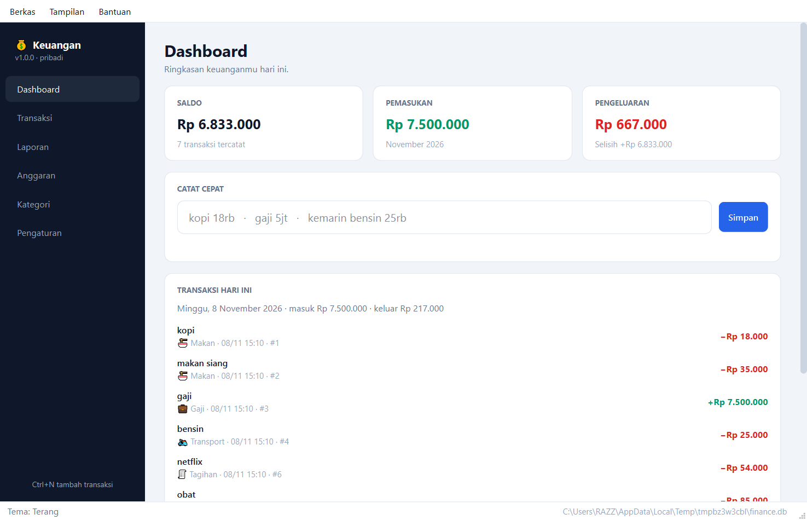

# Keuangan — aplikasi desktop Windows

Aplikasi pencatatan keuangan pribadi berbentuk aplikasi Windows sungguhan
(Qt/PySide6): jendela sendiri, sidebar, tabel, dialog, installer, dan
uninstaller. Tidak butuh browser, terminal, atau koneksi internet.

Proyek ini satu repo dengan bot Telegram. Logika pencatatan **satu sumber**
(`bot/`), jadi perilaku di dua antarmuka tidak pernah berbeda.



---

## Coba langsung

```powershell
.\.venv\Scripts\python.exe -m desktop
```

## Pasang sebagai aplikasi Windows

Installer ada di `dist\installer\Keuangan-Setup-1.0.0.exe` (34 MB). Klik dua
kali, atau dari PowerShell:

```powershell
.\dist\installer\Keuangan-Setup-1.0.0.exe
```

Dipasang per-user tanpa UAC ke `%LOCALAPPDATA%\Programs\Keuangan`, dengan
shortcut Start Menu dan Desktop.

---

## Fitur

| Halaman | Isi |
|---|---|
| **Dashboard** | Saldo, pemasukan/pengeluaran bulan ini, transaksi hari ini, peringatan anggaran, kotak catat cepat |
| **Transaksi** | Tabel semua transaksi; filter bulan/jenis, cari catatan, ubah, hapus, undo |
| **Laporan** | Ringkasan bulanan, pengeluaran per kategori, tren 12 bulan, export CSV |
| **Anggaran** | Batas bulanan per kategori dengan progress bar dan status |
| **Kategori** | CRUD kategori + kata kunci untuk tebakan otomatis |
| **Pengaturan** | Nama, zona waktu, tema, lokasi data, backup, impor database |

Pencatatan memakai bahasa manusia yang sama dengan versi Telegram:

```
kopi 18rb
makan siang 35k
gaji 7.5jt
kemarin bensin 25.000
+500rb dari jual motor
kopi 18rb @Makan
```

Format nominal yang diterima: `18rb`, `1,5jt`, `25.000`, `Rp25.000`,
`kopi18rb` (tanpa spasi). Tanggal: `kemarin`, `2 hari lalu`, `15/10`.

---

## Di mana data disimpan

```
%APPDATA%\Keuangan\finance.db        database SQLite
%APPDATA%\Keuangan\exports\          ledger-<id>.csv, diperbarui otomatis
%APPDATA%\Keuangan\backups\          backup harian (7 terakhir)
%APPDATA%\Keuangan\keuangan.log      log
```

Data **tidak** pernah ditulis ke folder instalasi, karena `Program Files`
(read-only) akan membuat penyimpanan gagal tanpa jejak. Semua data tetap di
komputer ini — tidak ada yang dikirim ke internet.

**Mode portable:** letakkan file kosong bernama `portable.txt` di sebelah
`Keuangan.exe`, maka data disimpan di `data\` di folder yang sama. Cocok untuk
flashdisk.

**Untuk pengujian:** set environment `KEUANGAN_DATA_DIR` ke folder lain.

---

## Struktur kode

```
bot/            logika inti, dipakai bot Telegram DAN aplikasi desktop
  entry.py        parse -> pilih jenis -> pilih kategori -> simpan
  parser.py       bahasa manusia -> nominal/tanggal/kategori
  ledger.py       query, laporan, anggaran, export
  csvsync.py      sinkronisasi CSV + sanitasi formula
desktop/        lapisan tampilan Qt
  service.py      semua operasi data, bebas Qt (mudah dites)
  paths.py        lokasi data (APPDATA / portable / env)
  theme.py        palet + stylesheet terang & gelap
  pages/          satu file per halaman
  dialogs.py      dialog transaksi, kategori, anggaran
  models.py       model tabel transaksi
packaging/      spec PyInstaller, skrip Inno Setup, ikon, panduan
```

`bot/handlers/*`, `bot/middlewares.py`, dan `bot/main.py` hanya dipakai bot
Telegram dan tidak diikutkan ke installer desktop.

---

## Build installer

```powershell
.\.venv\Scripts\python.exe -m pip install -r requirements-build.txt
winget install JRSoftware.InnoSetup
powershell -ExecutionPolicy Bypass -File packaging\build.ps1
```

`build.ps1` menjalankan berurutan: tes → ikon → PyInstaller → uji exe →
Inno Setup. Kalau satu langkah gagal, build berhenti.

Hasil:

```
dist\Keuangan\Keuangan.exe                    106 MB (folder, 788 file)
dist\installer\Keuangan-Setup-1.0.0.exe        34 MB
```

`--onedir` dipakai, bukan `--onefile`: satu file harus mengekstrak 106 MB ke
folder temp setiap kali dijalankan (lambat) dan lebih sering memicu
false-positive antivirus.

---

## Verifikasi

```powershell
# semua tes (bot + desktop service + UI offscreen)
.\.venv\Scripts\python.exe -m pytest

# aplikasi desktop tanpa jendela: semua halaman, dialog, tema
.\.venv\Scripts\python.exe scripts\desktop_smoke.py

# tangkapan layar semua halaman (terang & gelap)
.\.venv\Scripts\python.exe scripts\desktop_screens.py

# .exe hasil build benar-benar jalan dan membuat data
.\.venv\Scripts\python.exe scripts\probe_exe.py

# siklus penuh: install -> jalan -> update -> uninstall
.\.venv\Scripts\python.exe scripts\probe_installer.py
```

---

## Masalah umum

**Aplikasi tidak terbuka.** Mungkin sudah berjalan (hanya satu instance
diizinkan). Cek taskbar; kalau tidak ada, akhiri `Keuangan.exe` di Task Manager.

**Antivirus memblokir.** Exe tidak ditandatangani digital. Tekan *More info* →
*Run anyway*, atau kecualikan folder aplikasi. Mode `onedir` dipilih justru
untuk mengurangi kejadian ini.

**Data terasa hilang setelah update.** Data tidak pernah ada di folder
aplikasi. Cek `%APPDATA%\Keuangan`. Kalau ada `portable.txt`, cek `data\` di
folder aplikasi.

**Pindah dari versi Telegram.** Pengaturan → *Impor database…* → pilih
`finance.db` milik bot. Database lama dibackup dulu, dan penyalinan memakai API
backup SQLite sehingga transaksi yang masih di file `-wal` ikut terbawa.
